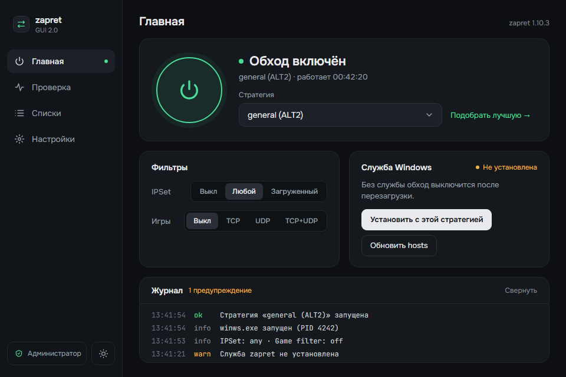
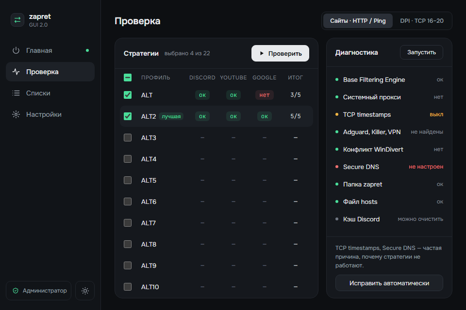
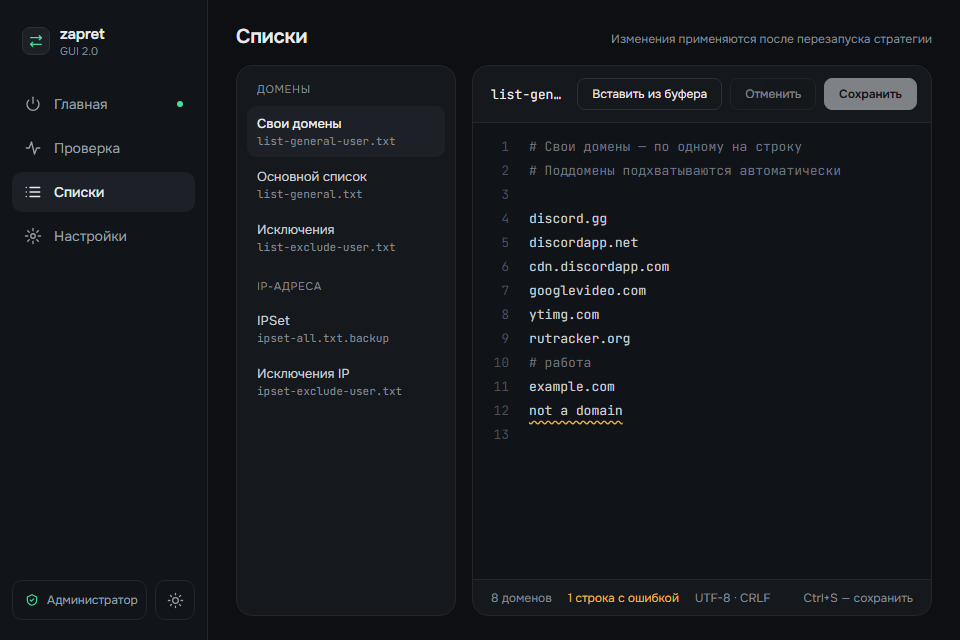
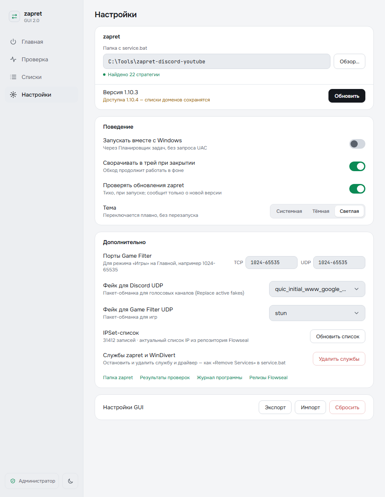

# ZapretGUI 2.0

Графическая оболочка для сборки [Flowseal/zapret-discord-youtube](https://github.com/Flowseal/zapret-discord-youtube) —
обхода блокировок Discord и YouTube на Windows.

ZapretGUI не заменяет и не модифицирует сам zapret: он запускает те же стратегии `general*.bat`,
ставит ту же службу и правит те же файлы, что `service.bat`. Обе программы можно использовать по очереди.



## Возможности

- **Главная** — включение обхода одной кнопкой, выбор стратегии, фильтры IPSet и Game, служба Windows
  («Установить с этой стратегией»), обновление hosts, журнал.
- **Проверка** — тест стратегий по алгоритму `test zapret.ps1` (сайты HTTP/TLS/ping и DPI TCP 16–20)
  с таблицей результатов и выбором лучшей; диагностика частых проблем и «Исправить автоматически».
- **Списки** — редактор своих доменов, исключений и IPSet: номера строк, подсветка ошибок,
  вставка ссылок из буфера, Ctrl+S.
- **Настройки** — папка zapret, обновление zapret с проверкой контрольной суммы (свои списки сохраняются,
  служба переустанавливается с той же стратегией), скачивание zapret при первом запуске, автозапуск без UAC,
  трей, порты Game Filter, активные фейки, обновление IPSet-списка, экспорт и импорт настроек.
- **Автопилот** — раз в 15 минут проверяет, открываются ли Discord и YouTube. Если стратегия перестала
  работать, предупреждает уведомлением или сам подбирает и включает рабочую (режим в Настройках).
- **Мой сайт** — почему не открывается конкретный сайт: списки, подмена DNS, IPSet, геоблокировка; подбор
  стратегии под сайт. **Починить Discord** — кэш, hosts, голосовые UDP-фильтры, сайты Discord, перезапуск.
- **Telegram** — обход блокировки Telegram через локальный MTProto-прокси
  [TgWsProxy](https://github.com/Flowseal/tg-ws-proxy) (Flowseal): скачивание с проверкой SHA-256, запуск и
  остановка, «Подключить Telegram» одной кнопкой, порт, секрет, DC → IP, обновления.
- **Мастер первого запуска** — найдёт или скачает zapret, подберёт стратегию, включит обход и предложит
  службу или автозапуск программы.
- **Обновление программы** — проверка новой версии ZapretGUI на GitHub, уведомление и установка по кнопке
  (установщик или замена portable-exe, с проверкой SHA-256 и перезапуском).
- Уведомления Windows: обход остановился, найден сбой, проверка закончилась в трее, вышла новая версия zapret.
- Светлая и тёмная темы с плавным переключением, режим «как в Windows».

| Проверка | Списки | Настройки |
|---|---|---|
|  |  |  |

## Требования

- Windows 10 1809+ или Windows 11, 64-бит.
- Права администратора: без них не работают `winws.exe`, драйвер WinDivert и службы.
  Программа сама запрашивает их при запуске (UAC).
- WebView2 — уже есть в Windows 10/11; установщик поставит его, если нет.

## Установка

1. Скачайте со страницы релизов один из файлов:
   - `ZapretGUI_2.0.0_x64-setup.exe` — установщик (Program Files, ярлык в «Пуске»);
   - `ZapretGUI_2.0.0_portable.exe` — один файл без установки.
2. Сверьте SHA-256 с `SHA256SUMS.txt` из того же релиза.
3. Запустите и подтвердите запрос UAC.

### Первый запуск

Программа сама поищет папку zapret (`C:\zapret*`, Рабочий стол, Загрузки, Документы).
Если не найдёт — откройте **Настройки**:

- **Обзор…** — укажите папку, где лежит `service.bat`;
- **Скачать zapret** — программа скачает последний релиз Flowseal с GitHub в `C:\zapret` (или в выбранную
  пустую папку) и проверит его по контрольной сумме.

Путь лучше выбрать без кириллицы, пробелов и OneDrive — так советует Flowseal.

## Как пользоваться

1. **Проверка → Проверить** — найдите стратегию, которая у вас работает (лучшая отмечается в таблице).
2. **Главная** — выберите её и нажмите кнопку питания.
3. Чтобы обход работал после перезагрузки без программы, нажмите **Установить с этой стратегией** —
   будет создана служба Windows `zapret`, как через `service.bat → Install Service`.
4. Свои сайты добавляйте в **Списки → Свои домены** (поддомены учитываются автоматически).
   Изменения применяются после перезапуска обхода — программа предложит это сделать.

Если установлена служба, кнопка питания включает и выключает **службу**, а смена стратегии
переустанавливает её (с подтверждением).

## Частые вопросы

**Антивирус ругается на WinDivert или удаляет `winws.exe`.**
Это известное поведение для любых сборок zapret (см. README Flowseal). Добавьте папку zapret в исключения.
Диагностика на экране «Проверка» покажет, если файлов драйвера не хватает.

**Не работает ни одна стратегия.**
Запустите **Проверка → Диагностика**: чаще всего мешают выключенные TCP timestamps, не настроенный
Secure DNS, VPN, Adguard, Killer или другой обход, держащий WinDivert. Безопасные исправления программа
сделает сама.

**Обновление zapret стёрло мои домены?**
Нет. При обновлении сохраняются `*-user.txt`, `ipset-all.txt(.backup)`, настройки фильтров (`*.enabled`),
активные фейки и отчёты проверок. Файлы `list-general.txt` и `list-exclude.txt` принадлежат Flowseal и
обновляются — поэтому свои домены храните в «Своих доменах».

**Чем ZapretGUI 2.0 отличается от 1.x?**
1.x управлял zapret, подставляя ответы в меню `service.bat`, и сломался, когда в Flowseal 1.10 поменялась
нумерация пунктов (кнопка «Обновить hosts» перезаписывала IPSet, установка службы не работала).
2.0 работает с файлами и службами напрямую и не зависит от меню. Настройки 1.x можно перенести:
**Настройки → Настройки GUI → Импорт** и выберите `gui_settings.json`.

**Где хранятся настройки и журнал?**
`%APPDATA%\ZapretGUI\` — `settings.json`, `logs\gui.log.*` (7 дней), `tests-last.json`.
Отчёты проверок — в `utils\test results\` папки zapret, в формате `test zapret.ps1`.

## Совместимость с service.bat

| Что | Где |
|---|---|
| Служба | `zapret`, автозапуск, имя стратегии в `HKLM\System\CurrentControlSet\Services\zapret` → `zapret-discord-youtube` |
| Game Filter | `utils\game_filter.enabled` (`mode=`, `tcp=`, `udp=`) |
| IPSet | `lists\ipset-all.txt` и `ipset-all.txt.backup` |
| Проверка обновлений | `utils\check_updates.enabled` |
| Свои списки | `lists\*-user.txt` |
| Тесты | `lists\ipset-all.test-backup.txt`, `ipset_switched.flag`, `utils\test results\` |

## Разработка

Стек: ядро на **Rust** (Tauri 2), интерфейс на **Svelte 5 + TypeScript** в WebView2.
Подробный план и решения — [PLAN.md](PLAN.md), дизайн — [DESIGN.md](DESIGN.md).

Нужны: Rust stable (MSVC), Visual Studio Build Tools (C++), Node.js 22.

```bash
npm install
```

```bash
npm run tauri dev
```

В режиме разработки программа запускается без прав администратора (плашка «Без прав администратора»);
релизная сборка всегда запрашивает права. Чтобы dev-версия не трогала рабочие настройки и работала рядом
с установленной копией:

```bash
ZAPRETGUI_DATA_DIR=./.dev-data npx tauri dev --config src-tauri/tauri.dev.json
```

Имитация сбоя для проверки автопилота (релизная сборка, от администратора, при включённом обходе):
стратегия, работавшая при первой проверке, считается «сломавшейся» — YouTube «не открывается», и она
исключается из подбора; первая проверка — через 15 с после включения обхода, повторная — через 10 с.

```bat
set ZAPRETGUI_AUTOPILOT_SIMULATE=1 && zapret-gui.exe
```

Интерфейс без ядра (заглушка в `src/lib/mock.ts`) открывается в обычном браузере — `npm run dev`,
параметры `?screen=check&state=on&tests=done&theme=light`.

Проверки:

```bash
npm run check
```

```bash
cd src-tauri && cargo fmt --check && cargo clippy --all-targets -- -D warnings && cargo test
```

Сетевые тесты (GitHub, hosts Flowseal, скачивание релиза) — `cargo test -- --ignored`.

Сборка `.exe` и установщика:

```bash
npx tauri build
```

Структура:

```
src/                  интерфейс: screens/ (4 экрана), components/, lib/ (api, состояние, заглушка)
src-tauri/src/
  commands.rs         команды IPC
  monitor.rs          фоновый опрос состояния
  tray.rs, update.rs  трей, сценарии обновления
  zapret/             стратегии и парсер .bat, запуск winws, служба, фильтры, списки,
                      проверка стратегий, диагностика, обновление
  sys/                Win32: службы, процессы, реестр, ICMP, Планировщик задач
src-tauri/tests/fixtures/flowseal-1.10.3/   стратегии Flowseal для тестов парсера
```

CI (`.github/workflows`): проверки и сборка на каждый push, релиз по тегу `v*`,
и раз в неделю — проверка, что стратегии свежего релиза Flowseal по-прежнему разбираются.

## Благодарности

- [Flowseal/zapret-discord-youtube](https://github.com/Flowseal/zapret-discord-youtube) — сборка zapret, стратегии,
  `service.bat` и `test zapret.ps1`, по которым построена логика программы.
- [bol-van/zapret](https://github.com/bol-van/zapret) — сам zapret и `winws`.
- [hyperion-cs/dpi-checkers](https://github.com/hyperion-cs/dpi-checkers) — набор целей DPI-теста.
- Шрифты [Onest](https://fonts.google.com/specimen/Onest) и [JetBrains Mono](https://www.jetbrains.com/lp/mono/) (OFL),
  иконки в стиле [Lucide](https://lucide.dev) (ISC).
